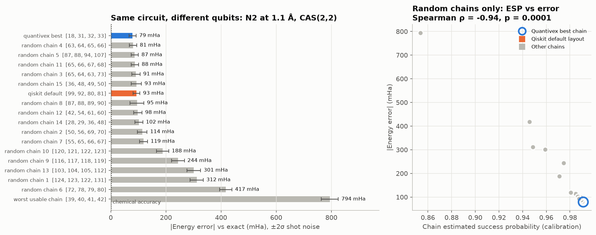

# Quantivex

**Give it IBM quantum-computer files; get back one folder with every result, checked and explained.**

Quantivex reads the calibration data IBM publishes for its processors and the results of jobs run on them. For
each chip it ranks the best qubits, simulates a small energy calculation under that chip's noise, and states
the error with a guaranteed 95% margin and a verdict: *reliable*, *not reliable* or *undecided*. For each real
hardware run it recomputes the energy from IBM's returned counts, checks the files have not changed, and compares
the measurement with what the noise model predicted. All numbers come from code; a language model then writes a
plain-language report, which is labelled unverified and checked number by number.



*First version (1.3), built for the 4th Open Scientific Intelligence Hackathon, October 2026.*

## Quick start

```bash
python -m venv .venv && source .venv/bin/activate      # Windows: .venv\Scripts\Activate.ps1
python -m pip install "quantivex[ibm] @ git+https://github.com/<your-org>/quantivex"
#   or, from a clone:  python -m pip install ".[ibm]"

export OPENAI_API_KEY=...            # or any provider below; needed only for the written report
quantivex process my_ibm_files/ --out results/
```

Open `results/report.md`. Without `--out`, results go to a new folder under `~/QuantivexData/results/`; nothing
is written inside the code folder. Try it on the bundled examples:

```bash
quantivex process examples/ --out example_results/
```

## Which IBM files it reads

| File | Where it comes from | What Quantivex does with it |
| --- | --- | --- |
| Calibration **CSV** | IBM Quantum Platform → Compute resources → a processor → *Calibration data* → download | converts it, ranks qubit chains, simulates the calculation, gives error ± margin and verdict |
| Calibration **JSON** (`BackendProperties`) | `backend.properties().to_dict()` in Qiskit | same as above |
| Quantivex snapshot JSON | `quantivex export --backend ibm_fez` or bundled data | same as above |
| **Hardware-run folder** | `quantivex ibm prepare / submit / fetch` (plan, circuits, IBM's raw result) | verifies checksums, recomputes energy from IBM's counts, margin and verdict, predicts the error from the calibration at preparation |
| A folder of any of these | | searched recursively (symbolic links and hidden files are ignored) |

Only CZ-native processors (IBM Heron: Fez, Kingston, Marrakesh, Torino, ...) are supported. Anything else is
listed under *Skipped* with the reason; one bad file never stops the batch.

## What you get

```text
results/
├── report.md                 start here: tables + language-model explanation (unverified, numbers checked)
├── summary.md / summary.json all results in one place
├── calibrations.csv          one row per calibration file
├── hardware.csv              one row per hardware run
├── figures/                  calibration_errors.png, hardware_errors.png
├── calibrations/<name>/      snapshot.json, conversion.json, dataset_summary.json,
│                             chains.json, chemistry.json, chip_map.png [, layout_comparison.*]
├── hardware/<name>/          analysis.json (energy, margin, verdict, integrity checks, prediction)
├── failures/                 one file per input that could not be processed (if any)
├── run.json                  versions, settings, input checksums, timings, report status
└── SHA256SUMS.txt            checksum of every file above
```

The folder is written under a temporary name and appears only when complete; an existing folder is never
overwritten. Exit codes: `0` complete, `1` some inputs failed, `2` nothing processed, `3` `--require-llm` was
given but no explanation could be written.

### Options

```bash
quantivex process INPUTS... --out DIR
  --molecule H2|N2|LiH  --bond-length 0.75  --active-space 2e2o|4e4o  --mode compact|uccsd
  --shots 4000  --seed 1234  --no-mitigation  --top-chains 5
  --compare-layouts [--random-chains 15]      # best vs worst vs Qiskit vs random qubit chains
  --no-prediction                             # skip the noise-model prediction for hardware runs
  --no-report | --require-llm                 # language-model report off, or mandatory
  --provider ... --model ... --base-url ...   # see below
```

From Python:

```python
from quantivex.process import ProcessConfig, process

result = process(["my_ibm_files/"], "results/", ProcessConfig(molecule="N2", bond_length=1.1))
print(result.exit_code, result.report_status)
```

## Language model

The model writes the explanation in `report.md` and powers the interactive assistant (`quantivex ask`,
`quantivex-gui`). It never produces a number that is used as a result.

| Provider | How |
| --- | --- |
| OpenAI | `--provider openai`, set `OPENAI_API_KEY` |
| Anthropic | `--provider anthropic --model MODEL_ID`, set `ANTHROPIC_API_KEY` (`pip install "quantivex[anthropic]"`) |
| Local (Ollama, LM Studio, vLLM) | `--provider ollama` or `--provider local --base-url http://localhost:1234/v1 --model ID` |
| Other OpenAI-compatible hosts | `--provider openai-compatible --base-url URL --model ID` |

Details: [docs/LLM_PROVIDERS.md](docs/LLM_PROVIDERS.md).

## Interactive assistant and real hardware

```bash
quantivex ask examples/ibm_torino_2025-02-26.json "Which 4 qubits should I use for N2 at 2.0 angstrom?"
quantivex-gui                                        # browser app, http://127.0.0.1:8501  (pip install ".[gui]")
```

Running on a real IBM processor is a separate, explicit workflow that the language model can never start:
`quantivex ibm prepare → inspect → submit --confirm --max-total-shots N → fetch`. See
[docs/IBM_EXECUTION.md](docs/IBM_EXECUTION.md). The resulting folder can be passed straight to `quantivex process`.

## How to read the verdicts

Errors are measured against the exact energy *of the same small model*:

- **reliable** (`MODEL_AGREEMENT_95`): the whole 95% interval lies within 1.6 mHa;
- **not reliable** (`OUTSIDE_TOLERANCE_95`): the whole interval lies beyond 1.6 mHa;
- **undecided** (`INCONCLUSIVE_95`): the interval crosses 1.6 mHa; more shots would decide.

The margin is the tighter of a Hoeffding and an empirical-Bernstein bound (Maurer & Pontil 2009). It covers
finite-shot sampling only, not calibration drift, device bias, crosstalk or basis-set error.

## What the first version shows

- *Simulation* (real `ibm_torino` calibration, N₂, 4 qubits): the qubit-chain score predicts the error
  (Spearman ρ = 0.94–0.96); the worst usable chain is 8–10× worse than the best; no clear gain over Qiskit's own
  layout (paired test p = 0.50–0.56). Details: [docs/benchmark.md](docs/benchmark.md).
- *Hardware* (10 runs of H₂ on IBM Fez, Kingston and Marrakesh, 50,000 shots, no read-out correction): errors
  106–213 mHa; none reached 1.6 mHa or beat Hartree–Fock; Kingston was best. The noise model ranks the chips
  correctly but predicts only about half of the measured error.

## Example data

The repository holds the software. Example data is attached to each GitHub release as two separate downloads:

| Download | Contents |
| --- | --- |
| `Quantivex_IBM_INPUTS_v1.3.0.zip` | IBM files: 10 calibration snapshots, a calibration CSV, a live calibration and 10 real hardware-run folders |
| `Quantivex_RESULTS_v1.3.0.zip` | the results folder `quantivex process` produced from exactly those inputs |

Download the inputs, run `quantivex process` on them, and compare with the results zip; or skip the examples and
process your own IBM files. Details: [docs/DATA_AND_OUTPUT_LOCATIONS.md](docs/DATA_AND_OUTPUT_LOCATIONS.md).

## Limits

- Noisy results for calibration files are simulations; the noise model omits crosstalk, leakage, coherent
  errors and drift. STO-3G basis, small active spaces, at most 8 qubits.
- Hardware runs execute a state optimised classically; this is not hardware-in-the-loop VQE.
- The CSV layout of IBM's website export has changed over time; the reader matches columns by name and records
  every assumption in `conversion.json`. Please open an issue with a sample file if one is not recognised.

## Development

```bash
python -m pip install -e ".[dev,gui,ibm,anthropic]"
pytest                                            # unit and integration tests
ruff check src tests scripts && ruff format --check src tests scripts && mypy src
python scripts/validate_results.py                # independent physics checks V1-V7 (~5 min)
```

Guides: [Prompt guide](docs/PROMPT_GUIDE.md) · [Experiment design](docs/EXPERIMENT_DESIGN.md) ·
[Installation](docs/INSTALLATION.md) · [IBM Quantum quick start (PDF)](docs/Quantivex_IBM_Quantum_Quick_Start.pdf) ·
[Data and output locations](docs/DATA_AND_OUTPUT_LOCATIONS.md) · [Reading results](docs/RESULTS_GUIDE.md) ·
[Calibration data](docs/CALIBRATION_DATA.md) · [IBM execution](docs/IBM_EXECUTION.md) ·
[Architecture](docs/ARCHITECTURE.md) · [References](docs/REFERENCES.md) · [Changelog](CHANGELOG.md) ·
[Contributing](CONTRIBUTING.md) · [Security](SECURITY.md)

License: MIT for project code; bundled IBM calibration data keeps its upstream Apache-2.0 attribution.
